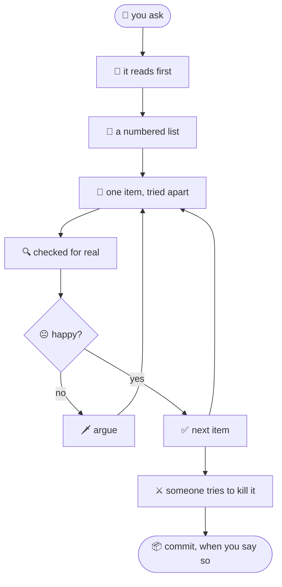

<p align="center">
  
</p>

<h1 align="center">grimoire</h1>

<p align="center">
  <b>grimoire</b> /ɡrɪmˈwɑːr/ — <i>a book of spells: instructions for making magic work.</i>
</p>

<p align="center">
  
  
  
  
</p>

<p align="center">
  
</p>

This is esoteric stuff. It's a pile of rules and rituals that, put together, make the AI work almost like magic. I don't fully know why. Nobody does. But it works very well for me, so here it is.

Every line in here started the same way: the AI did something dumb, I complained, and we wrote down why. Months of complaining, distilled. You're welcome.

<p align="center"></p>

## The only three rules that matter

These aren't for the AI. They're for you.

> [!IMPORTANT]
> **1. Argue with everything.** Question everything until you're happy.
>
> *Discutile todo. Cuestionale todo, hasta que estés contento.*

> [!TIP]
> **2. Ask yourself if you're happy with the result it's giving you.** You have to be happy with the process you're having, and want to work that way all day long.
>
> *Preguntate si estás contento con el resultado que te está dando. Tenés que ser feliz con el proceso que estás teniendo, y tener ganas de trabajar todo el día de ese modo.*

> [!CAUTION]
> **3. Never forget that users are idiots.** They will always do the worst possible thing to ruin your life.
>
> *Nunca te olvides de que los usuarios son idiotas. Siempre van a hacer lo peor posible para joderte la vida.*

Everything below is just those three rules, explained badly.

<p align="center"></p>

## Why I work like this

> "He who has a why to live can bear almost any how."
> — Nietzsche

So this is the why. The how is in the plugin; you don't need to read it.

### 🜂 Doubt everything, especially the AI

> "If you would be a real seeker after truth, it is necessary that at least once in your life you doubt, as far as possible, all things."
> — Descartes

The AI is brilliant, fast and very confident. Two of those are great. It will tell you "it works" about code it never ran. It will tell you a method is "within 10%" because it tried four examples it liked. So I make it prove things: run it on all the data, open the real browser, show me the before and after. Then I argue anyway.

> "The first principle is that you must not fool yourself — and you are the easiest person to fool."
> — Richard Feynman

The AI is the second easiest.

### 🜁 One thing at a time

> "The journey of a thousand miles begins with a single step."
> — Lao Tzu

Not with forty-nine steps at once in one giant diff that nobody reads. Big work becomes a numbered list. It does one item, I look at it, we tick it, next. It feels slower. It's much faster, because nothing has to be redone.

### 🜃 You decide. Always.

> "Man is condemned to be free."
> — Jean-Paul Sartre

So is the developer. The AI proposes, measures, builds. You decide: the design, the trade-off, the number. And when it decides something on its own (it will), it has to say so: "decisions I made: 40, because…". Otherwise you find out three weeks later that the limit you never chose is now in production.

And when you say "I don't like the texts", it changes **the texts**. Not the whole page. I learned that one the hard way.

### 🜄 Less is more (it took me a long time to write this short)

> "I have made this longer than usual because I have not had time to make it shorter."
> — Blaise Pascal

> "Perfection is achieved, not when there is nothing more to add, but when there is nothing left to take away."
> — Antoine de Saint-Exupéry

The AI loves machinery. Ninety lines of custom code where a library does it in twenty. A helper function used exactly once. A comment explaining the history of humanity above a for-loop. No. Smallest thing that works. Use the library. Reasons go in the commit, not in the code.

> "Everything should be made as simple as possible, but not simpler."
> — Einstein, probably[^einstein]

### ☿ Don't talk about what you didn't check

> "Whereof one cannot speak, thereof one must be silent."
> — Wittgenstein

If it didn't run, it doesn't "work". If it didn't render, it doesn't "look fine". It says what it checked, what it didn't, and shuts up about the rest.

### 🜍 Remember the users

> "Hell is other people."
> — Jean-Paul Sartre

> "Anything that can go wrong will go wrong."
> — Murphy

See rule 3. So we test with fake users who have exactly the wrong permissions, we load-test with many of them, and we try to break our own security before someone else does. A hidden button is not protection. The server says no, or nobody does.

### 🜔 Let someone else try to kill it

Every round ends the same way: other reviewers get the code (not my opinion of it), something tries to prove each finding wrong, and a model from another company reads the diff looking for races and holes. It finds things. It always finds things.

### 🜚 Be happy

> "One must imagine Sisyphus happy."
> — Albert Camus

You'll push the same rock every day: another bug, another review, another "why did you change that?". That's fine. If the process makes you miserable, change the process. That's rule 2, and it's not a joke. Well, it's a little bit of a joke.

And if it all goes wrong: <kbd>Esc</kbd> <kbd>Esc</kbd>. Rewind. Nobody saw anything.

### 🝆 Write down your mistakes

> "Life can only be understood backwards; but it must be lived forwards."
> — Kierkegaard

Every time the AI gets corrected, it saves the rule and the reason. Next week the same mistake doesn't happen. This whole repo is that, backwards.

<p align="center"></p>

## The ritual



## Does it work?

It found security holes before anyone else did. It caught races the tests missed. It killed optimistic numbers before they reached users. The frontend finally looks like one app. And I mostly stopped repeating myself.

Nobody knows exactly why. That's why it's a grimoire.

<p align="center"></p>

<details>
<summary><b>📦 The boring part: install and what's inside</b></summary>

### Install

```
/plugin marketplace add mpierangeli-q99/grimoire
/plugin install grimoire@grimoire
```

The skills load by themselves when the task matches. A short `SessionStart` hook adds the few always-on rules (one item at a time, say what you decided, commit only when asked) to every session; see `plugins/grimoire/hooks/session-start.md`. Don't want it? Disable the plugin with `/plugin`.

### A normal round

1. Read the docs and the code first.
2. Plan as a numbered list, on a page with real examples and 2–4 versions for anything visual.
3. One item at a time.
4. Try it in a scratchpad on real data, then bring it into the repo.
5. Verify for real: tests, real browser, real permissions, all the data.
6. Adversarial review.
7. Report: what changed, what was checked, what wasn't, decisions it made.
8. Commit when you say so. You push.

### The spells

| Skill | When it kicks in |
|---|---|
| `working-agreement` | Every task: checklist flow, you decide, name the picks, subagent briefs, git rules |
| `code-style` | Writing or cleaning code: the cleanup guide, libraries, licences, errors, data rules |
| `testing-rules` | Tests: contracts not copy, no model names, no tests for switches, targeted runs |
| `frontend-ui` | UI: respect what exists, no hardcoded sizes, screens fit the window, server-side permissions, help docs |
| `design-system` | Standardizing the frontend: one palette, type scale, chart setup, codemod + lint guard, pixel diffs |
| `llm-agents` | Agents and prompts: agnostic loop, judgement in prompts, real names, agents that doubt |
| `llm-providers` | Routes, reasoning effort, model comparisons, every provider working |
| `dependency-bumps` | Bumps and security sweeps: read what's new, quarantine, isolated trial, real-data diff |
| `measure-before-claiming` | Any accuracy, cost or "it's identical" claim |
| `verify-in-browser` | Visual constraints and logged-in screens, checked in a real browser |
| `test-accounts` | Permission matrix users, test data, realistic load |
| `security-review` | Auth, agent SQL/code, fetching, uploads, secrets |
| `adversarial-review` + `adversarial-verifier` agent | Before "done": reviewers, refuters, second-model pass |
| `artifacts` | Shared pages: real examples, many charts, several versions, living fix lists |
| `release-flow` | Pushing across repos: shared library first, then pins; quarantine; client plugins on a branch |
| `capture-feedback` | Turns your corrections into rules |

### What it doesn't carry

Project facts (ports, containers, test tokens) go in each repo's `CLAUDE.md`. Your own decisions build up in your own Claude memory. The plugin is the starting point; your complaints make it yours.

</details>

[^einstein]: He probably never said it. See "doubt everything".
